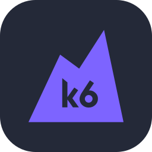

<h1 align="center">👋 Hello, I'm Julian</h1>
<h3 align="center">
  💼  Software Engineer in Test &nbsp;&nbsp;|&nbsp;&nbsp;🤖 Automation Strategist &nbsp;&nbsp;|&nbsp;&nbsp;🧑🏻‍🔬 Quality Advocate
</h3>

  

---

## 🧠 About Me

- 💼 **Title**: Software Engineer in Test
- 🚀 I specialize in **building resilient and maintainable automated testing frameworks**
- 🧪 Passionate about **automating complex business logic** and ensuring **end-user confidence**
- 🎯 Championing **testability**, **observability**, and quality integration across the SDLC

---

## 🛠️ Tech Stack

### 🧪 Testing

  
  
  
  

### 🧰 Languages & Tools

  

### 🤖 AI Tools

  
  

---

### 📫 Let's Connect

* ✉️ Email: `julian.wang.qae@gmail.com`
* 📍 Based in Taiwan | Open to remote-friendly teams

<picture>
  <source media="(prefers-color-scheme: dark)"
    srcset="https://raw.githubusercontent.com/JulianWangHZ/JulianWangHZ/output/pacman-contribution-graph-dark.svg">
  <source media="(prefers-color-scheme: light)"
    srcset="https://raw.githubusercontent.com/JulianWangHZ/JulianWangHZ/output/pacman-contribution-graph.svg">
  
</picture>

